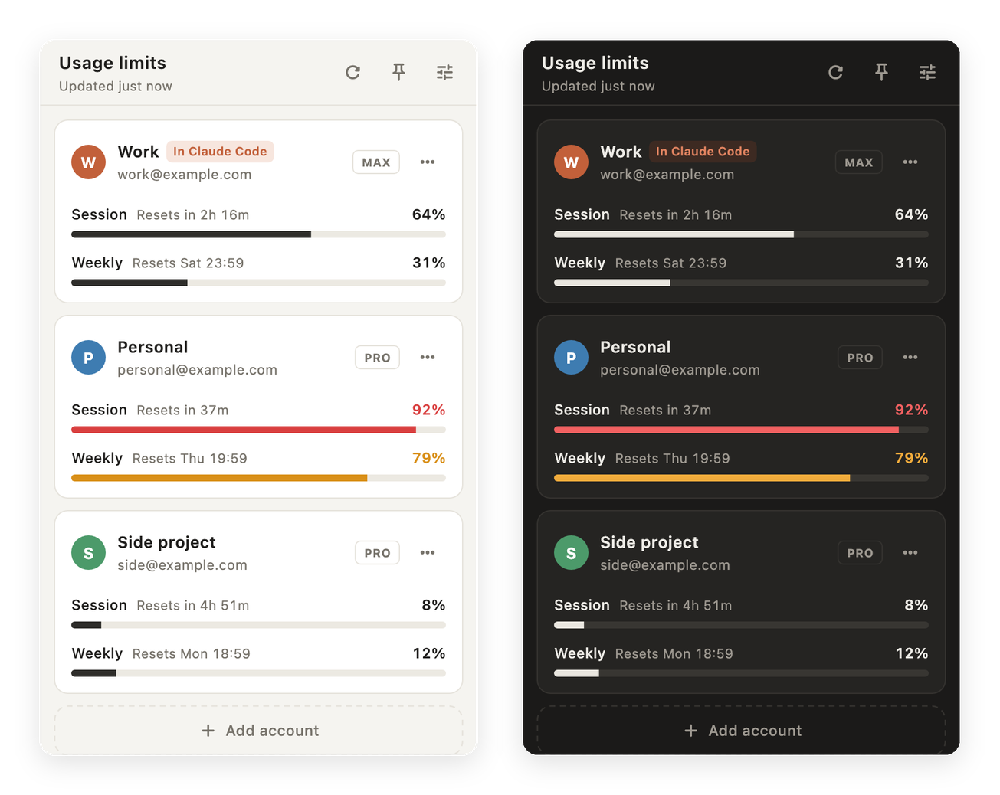

<p align="center">
  
</p>

<h1 align="center">Usage Monitor</h1>

<p align="center">
  A menu bar app for macOS and a system tray app for Windows that shows the plan limits of all your Claude accounts at once.<br>
  No more signing out and back in just to check how much of a session or week is left.
</p>

<p align="center">
  
</p>

## Features

- **Every account in one panel.** Each account shows its 5-hour session and weekly usage, with per-model weekly limits when your plan has them.
- **Countdowns.** Each limit shows when it resets ("Resets in 2h 16m", "Resets Thu 19:59").
- **Menu bar summary.** The menu bar shows each account's session usage (`64% · 92% · 8%`). Right-click it for a quick list. On Windows, hover over the tray icon to see it.
- **Switch VS Code to any account in one click.** Press **Switch** on a card, or pick the account from the menu bar's right-click menu. Claude Code in VS Code changes accounts without signing out; the account it uses has an **In VS Code** tag. This also works with VS Code Insiders, Cursor and Windsurf.
- **Every account behaves the same.** Each account folder links to `~/.claude`'s settings, memory, chat history, and your own skills and plugins. Account-synced skills from claude.ai stay per account.
- **Menu bar or screen edge.** Open the panel from the menu bar icon, or rest the pointer on the right edge of the screen and the panel slides in without taking focus (macOS only).
- **Warning colours.** A bar turns amber at 75% and red at 90%.
- **Open at login**, on by default. You can switch it off in Settings.
- Light and dark mode follow the system.

## How it works

Each account gets its own Claude Code profile folder: `~/.claude-accounts/<name>` (`%USERPROFILE%\.claude-accounts\<name>` on Windows). When you add an account, the app opens a terminal window and runs `claude auth login` for that folder, and you sign in once in your browser. Your normal Claude Code login (`~/.claude`) is not touched.

To read the limits, the app starts Claude Code for each profile and sends it the read-only `get_usage` control request. That is the same data the `/usage` command shows.

- **No prompt is sent,** so checking uses none of your limits.
- **The app never reads, stores or sends a login token.** Claude Code handles authentication itself.
- Usage is refreshed every 5 minutes by default (1–30 in Settings), when you open the panel, and right after a limit resets.

## Requirements

- macOS 12 or later (macOS 13 or later for Open at login), or Windows 10 or 11
- [Claude Code](https://code.claude.com), either the CLI or the VS Code / Cursor extension. The app finds the `claude` binary by itself; you can set its path in Settings.
- A Claude Pro, Max, Team or Enterprise plan. API-key logins have no plan limits to show.

## Install

### macOS

There is no signed download yet, so build it from source with [Flutter](https://docs.flutter.dev/get-started/install/macos). The build script makes a drag-to-install DMG in `dist/`:

```sh
git clone https://github.com/bek-n/usage-monitor.git
cd usage-monitor
pip3 install dmgbuild
macos/packaging/make_dmg.sh
open "dist/Usage Monitor 1.0.0.dmg"
```

Drag **Usage Monitor** onto **Applications**, then open it from Applications. The app isn't notarized, so a DMG downloaded from the internet needs a right-click → **Open** the first time.

Then click the gauge icon in the menu bar and choose **Add account**.

### Windows

Download `Usage Monitor Setup <version>.exe` from the latest run of the **Windows build** workflow (or from a release), and run it. It installs for your user only, so it doesn't ask for administrator rights. The installer isn't signed, so SmartScreen may warn you the first time: choose **More info** → **Run anyway**.

Then click the gauge icon next to the clock on the taskbar and choose **Add account**. If Windows hides the icon behind the **^** arrow, drag it onto the taskbar.

To build it yourself on Windows, install [Flutter](https://docs.flutter.dev/get-started/install/windows/desktop) and [Inno Setup 6](https://jrsoftware.org/isinfo.php), then run:

```powershell
windows\packaging\make_installer.ps1
```

The installer and a zip of the same files are written to `dist\`. Flutter builds for the machine it runs on, so an ARM PC makes an ARM build.

> If your browser is already signed in to a different Claude account, sign out there first or open the sign-in link in a private window.

## Switching accounts

**Switch** sets `CLAUDE_CONFIG_DIR` in the Claude Code extension's `claudeCode.environmentVariables` setting, in your editor's user `settings.json`. The extension notices within a second, and new Claude chats use the new account. The app changes only that one setting and keeps your comments and formatting. It saves the previous version next to the file as `settings.json.usage-monitor-backup`.

Switching to your main login, or to an account that is the same as your main login, removes the setting again, so Claude Code uses `~/.claude`.

Account folders share `~/.claude`'s settings, memory and history through links. The app only adds a link where nothing exists yet; if an account already has its own copy of something, its card says so and the app leaves it alone. You can turn linking off in Settings.

On Windows, folders are always linked. Files (`settings.json`, `CLAUDE.md`, `keybindings.json`) can only be linked when [Developer Mode](https://learn.microsoft.com/windows/apps/get-started/enable-your-device-for-development) is on; otherwise they are not shared.

To use an account in the terminal, use **Copy terminal command** in the card's ⋯ menu:

```sh
CLAUDE_CONFIG_DIR=~/.claude-accounts/work claude
```

On Windows it copies the PowerShell version:

```powershell
$env:CLAUDE_CONFIG_DIR = 'C:\Users\you\.claude-accounts\work'; claude
```

## Development

```sh
flutter test
flutter run -d macos    # or: flutter run -d windows
```

The code is in `lib/src/`:

| File | What it does |
|------|--------------|
| `claude_cli.dart` | Finds the `claude` binary and talks to it |
| `editor_settings.dart`, `jsonc.dart` | Switches the editor's account by editing its `settings.json` |
| `monitor.dart` | Keeps the accounts and the refresh schedule |
| `tray_panel.dart` | The menu bar item and the panel window |
| `ui/` | The panel's screens |

## Caveats

- `get_usage` is marked experimental in the Claude Agent SDK, so a future Claude Code release may change it.
- The screen-edge panel is macOS only for now.

## License

[MIT](LICENSE)

Usage Monitor is an independent project and is not affiliated with or endorsed by Anthropic. Claude is a trademark of Anthropic, PBC.
